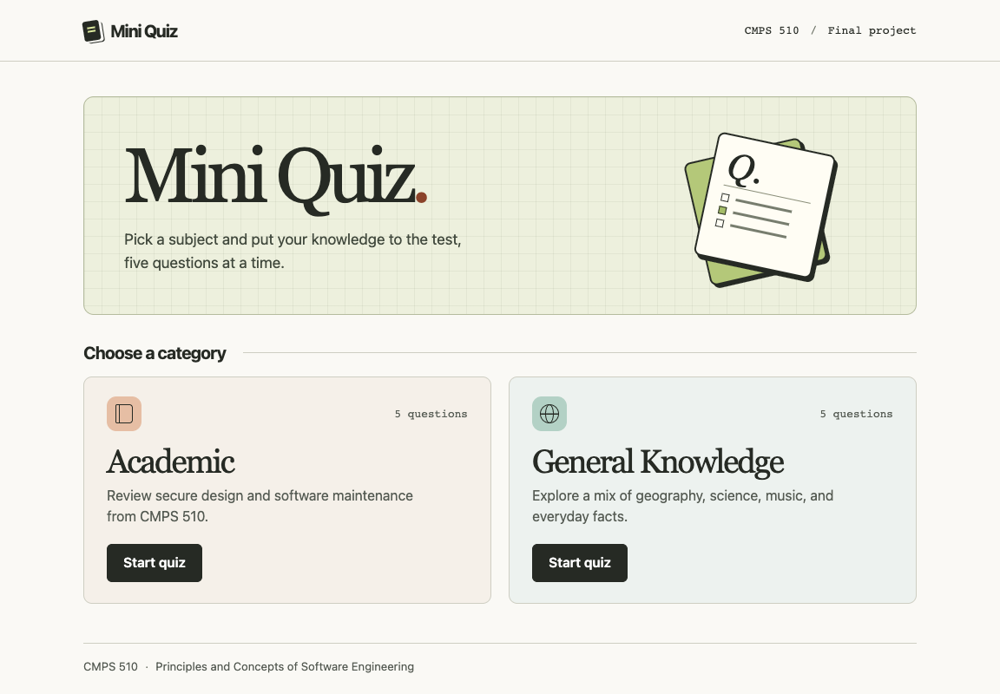

# Mini Quiz

A five-question quiz for the CMPS 510 final individual project. Choose **Academic** for software engineering or **General Knowledge** for a mix of science, geography, and music. Each answer gives immediate feedback and a short explanation. A correct answer earns one point. At the end, see your score out of five, try the same round again, or choose the other category.

Curious why Mars looks red? Try General Knowledge. Prefer to untangle a tricky bit of code? Start with Academic.

**[Play the Mini Quiz](https://palash1765.github.io/cmps510-mini-quiz/)**

## Run locally

Open `index.html` in a browser and select **Start quiz** under either category. The app runs entirely in the browser using plain HTML, CSS, and JavaScript. Refreshing the page starts a new session.

## How the quiz works

- `index.html` defines the landing, question, and result screens. `styles.css` handles the desktop and phone layouts.
- `questions.js` holds five questions per category. Each question has four choices, a correct answer index starting at zero, and an explanation.
- `quiz.js` tracks the current category, question, and score. It accepts one answer per question and resets the round when the player selects **Try Again**.

## Score check

In the Academic round, selecting **B, A, A, D, A** gives **3/5**. Questions 1, 3, and 4 earn one point each. This run was checked in Chrome, along with an all-incorrect run (0/5), a perfect General Knowledge run (5/5), repeat clicks, retry, category switching, and the phone layout.

## Course sources and tools

The Academic questions use concepts from Dr. Tsige Tessema's CMPS 510 lectures *Secure and Dependable Software Engineering* and *Software Maintenance and Evolution*. The questions and examples were written for this quiz.
